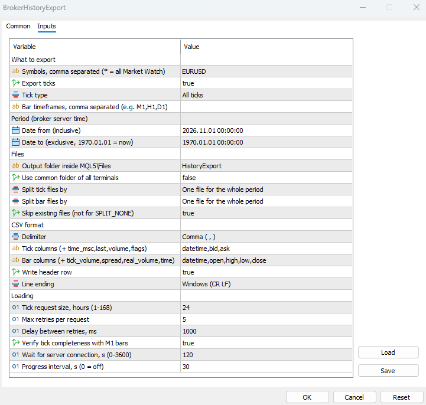

# Broker history export service for MetaTrader 5

An MQL5 service for MetaTrader 5. The service exports the tick history and the bar history of your broker to CSV files.

The service gets the data from the broker server through the terminal. It does not use the Strategy Tester. The service does not use a chart.

## Contents

- [Broker history export service for MetaTrader 5](#broker-history-export-service-for-metatrader-5)
  - [Contents](#contents)
  - [Features](#features)
  - [Requirements](#requirements)
  - [Installation](#installation)
  - [Start an export](#start-an-export)
  - [Stop an export](#stop-an-export)
  - [Inputs](#inputs)
    - [What to export](#what-to-export)
    - [Period](#period)
    - [Files](#files)
    - [CSV format](#csv-format)
    - [Data download](#data-download)
  - [Output files](#output-files)
  - [CSV format](#csv-format-1)
    - [Tick columns](#tick-columns)
    - [Bar columns](#bar-columns)
    - [Read a file in Python](#read-a-file-in-python)
  - [How the service works](#how-the-service-works)
    - [Continue an interrupted export](#continue-an-interrupted-export)
  - [GAP warnings](#gap-warnings)
  - [Journal](#journal)
  - [Limitations](#limitations)
  - [Examples](#examples)
    - [Ticks of one symbol, one file for each month](#ticks-of-one-symbol-one-file-for-each-month)
    - [Bars only, three timeframes](#bars-only-three-timeframes)
    - [Bid and Ask only, for Linux](#bid-and-ask-only-for-linux)
  - [License](#license)

## Features

- Exports ticks, bars, or ticks and bars together.
- Exports bars of all 21 MetaTrader 5 timeframes, from `M1` to `MN1`.
- Exports one symbol, a list of symbols, or all symbols in Market Watch.
- Writes one file for the full period, or one file for each year, month or day.
- Gets the data in small parts. Thus, a long period does not use much memory.
- Compares the ticks with the M1 bars. The service shows a warning for each period with missing ticks.
- Continues an interrupted export. The service does not write the files that are complete.
- Writes CSV files that pandas can read without settings.

## Requirements

- MetaTrader 5.
- A connection to the trade server of your broker.
- Sufficient disk space. One year of ticks for one forex symbol can use some GB.

## Installation

1. Find the data folder of the terminal. In MetaTrader 5, click **File → Open Data Folder**.
2. Copy the folder `mt5-broker-history-export` into `MQL5\Services\`.
3. Open `BrokerHistoryExport.mq5` in MetaEditor.
4. Compile the file (**F7**).
5. Make sure that the compiler shows `0 errors`.

You can also clone the repository directly:

```
cd "<data folder>\MQL5\Services"
git clone <repository URL> mt5-broker-history-export
```

## Start an export

1. In MetaTrader 5, open the **Navigator** window (**Ctrl+N**).
2. Expand **Services**.
3. Right-click **BrokerHistoryExport**.
4. Click **Add Service**.
5. On the **Inputs** tab, set the parameters. Refer to [Inputs](#inputs).
6. Click **OK**.



The service starts immediately. It shows the progress in the **Experts** tab of the **Toolbox** window.

When the export is complete, the service stops automatically.

You can add more than one service instance with different parameters. The instances operate in parallel.

> **Note:** If you close the terminal during an export, the terminal starts the instance again at the next start. Refer to [Continue an interrupted export](#continue-an-interrupted-export).

## Stop an export

1. In the **Navigator** window, right-click the service instance.
2. Click **Stop**.

The service deletes the incomplete file. The complete files stay on the disk.

## Inputs

### What to export

| Input | Default | Description |
|---|---|---|
| `InpSymbols` | `EURUSD` | Symbols, separated by commas. Use `*` for all symbols in Market Watch. Use the symbol names of your broker, with the suffix (for example, `EURUSD.r`). |
| `InpExportTicks` | `true` | Set to `true` to export ticks. |
| `InpTickType` | `TICKS_ALL` | `TICKS_ALL`: all ticks. `TICKS_INFO`: Bid and Ask changes only. `TICKS_TRADE`: Last and Volume changes only (exchange symbols). |
| `InpBarTimeframes` | empty | Timeframes, separated by commas (for example, `M1,H1,D1`). If this input is empty, the service does not export bars. |

You must enable ticks, bars, or both. To export only bars, set `InpExportTicks` to `false` and set `InpBarTimeframes`.

### Period

| Input | Default | Description |
|---|---|---|
| `InpDateFrom` | `2026.11.01 00:00` | Start of the period. This time is included. |
| `InpDateTo` | `0` | End of the period. This time is not included. `0` is the current server time. |

All times are in the time zone of the broker server.

> **Note:** The Inputs window shows the value `0` as `1970.01.01 00:00:00`. This value is correct. It means "now".

### Files

| Input | Default | Description |
|---|---|---|
| `InpOutputFolder` | `HistoryExport` | Folder in `MQL5\Files`. The service creates the folder. |
| `InpUseCommonFolder` | `false` | Set to `true` to write to the common folder of all terminals (`%APPDATA%\MetaQuotes\Terminal\Common\Files`). |
| `InpTickSplitMode` | `SPLIT_NONE` | How to split the tick files. Refer to [Output files](#output-files). |
| `InpBarSplitMode` | `SPLIT_NONE` | How to split the bar files. This value applies to all timeframes. |
| `InpSkipExisting` | `true` | Set to `true` to skip the files that exist. This input has no effect with `SPLIT_NONE`. |

### CSV format

| Input | Default | Description |
|---|---|---|
| `InpDelimiter` | `DELIM_COMMA` | Delimiter: comma, semicolon or tab. |
| `InpTickColumns` | `datetime,bid,ask` | Tick columns and their order. Possible values: `datetime`, `bid`, `ask`, `time_msc`, `last`, `volume`, `flags`. Refer to [Tick columns](#tick-columns). |
| `InpBarColumns` | `datetime,open,high,low,close` | Bar columns and their order. Possible values: `datetime`, `open`, `high`, `low`, `close`, `tick_volume`, `spread`, `real_volume`, `time`. Refer to [Bar columns](#bar-columns). |
| `InpWriteHeader` | `true` | Set to `true` to write a header row. |
| `InpCrlfType` | `CRLF_WINDOWS` | Line end: `CRLF_WINDOWS` (CR LF), `CRLF_LINUX` (LF), `CRLF_MACOS` (CR). Use `CRLF_LINUX` for Linux and modern macOS. |

Column lists:

- Always use commas between the column names, also with a different `InpDelimiter`.
- Upper case and lower case letters are equal. The service ignores spaces.
- You can use only some columns, in the order that you need.
- An unknown name or a duplicate name is an error. The service does not start the export.

### Data download

| Input | Default | Description |
|---|---|---|
| `InpChunkHours` | `24` | Size of one tick request, in hours (1–168). Use a smaller value for very active symbols. |
| `InpMaxRetries` | `5` | Maximum number of retries for one request. |
| `InpRetryDelayMs` | `1000` | Time between retries, in milliseconds. |
| `InpVerifyTicksWithM1` | `true` | Set to `true` to compare the ticks with the M1 bars. Refer to [GAP warnings](#gap-warnings). |
| `InpConnectTimeoutSec` | `120` | Maximum time to wait for the server connection, in seconds (0–3600). |
| `InpProgressIntervalSec` | `30` | Time between progress lines in the journal, in seconds. `0` disables the progress lines. |

## Output files

The service puts the files of each symbol in a subfolder with the symbol name.

`<TYPE>` is `TICKS` or the timeframe name (for example, `M1`, `H4`).

| Split mode | File name |
|---|---|
| `SPLIT_NONE` | `<SYMBOL>\<SYMBOL>_<TYPE>_<FROM>_<TO>.csv` |
| `SPLIT_YEAR` | `<SYMBOL>\<SYMBOL>_<TYPE>_<YYYY>.csv` |
| `SPLIT_MONTH` | `<SYMBOL>\<SYMBOL>_<TYPE>_<YYYY-MM>.csv` |
| `SPLIT_DAY` | `<SYMBOL>\<SYMBOL>_<TYPE>_<YYYY-MM-DD>.csv` |

`<FROM>` and `<TO>` have the format `YYYYMMDD`. If `InpDateTo` is `0`, `<TO>` is the current server date.

Example: EURUSD, ticks and the timeframes M1 and H1, default split mode:

```
MQL5\Files\HistoryExport\
└── EURUSD\
    ├── EURUSD_TICKS_20261101_20261113.csv
    ├── EURUSD_M1_20261101_20261113.csv
    └── EURUSD_H1_20261101_20261113.csv
```

The same export with `InpTickSplitMode = SPLIT_MONTH` and `InpBarSplitMode = SPLIT_YEAR`:

```
MQL5\Files\HistoryExport\
└── EURUSD\
    ├── EURUSD_TICKS_2026-11.csv
    ├── EURUSD_M1_2026.csv
    └── EURUSD_H1_2026.csv
```

Rules:

- A bar goes into the file of its open time.
- The service does not write a file for a period without data.
- The service replaces the characters `\ / : * ? " < > |` in the symbol name with `_`.

## CSV format

All files:

- Encoding: ASCII.
- Decimal separator: point (`.`).
- Time: server time of the broker.

### Tick columns

Use these values in `InpTickColumns`. The default is `datetime,bid,ask`.

| Column | Default | Format |
|---|---|---|
| `datetime` | Yes | Tick time, `YYYY.MM.DD HH:MM:SS.mmm` |
| `bid` | Yes | Bid price, with the digits of the symbol |
| `ask` | Yes | Ask price, with the digits of the symbol |
| `time_msc` | No | Tick time, milliseconds from 1970.01.01 |
| `last` | No | Price of the last deal, with the digits of the symbol (usually 0 for forex) |
| `volume` | No | Volume of the last deal, without trailing zeros (usually 0 for forex) |
| `flags` | No | Bit mask. Refer to the table below. |

Example with the default columns:

```csv
datetime,bid,ask
2026.01.02 10:00:00.123,1.03512,1.03514
2026.01.02 10:00:00.310,1.03513,1.03514
```

Example with all columns (`InpTickColumns = datetime,bid,ask,time_msc,last,volume,flags`):

```csv
datetime,bid,ask,time_msc,last,volume,flags
2026.01.02 10:00:00.123,1.03512,1.03514,1767348000123,0.00000,0,6
2026.01.02 10:00:00.310,1.03513,1.03514,1767348000310,0.00000,0,2
```

Tick flags:

| Value | Constant | Meaning |
|---|---|---|
| 2 | `TICK_FLAG_BID` | Bid changed |
| 4 | `TICK_FLAG_ASK` | Ask changed |
| 8 | `TICK_FLAG_LAST` | Last changed |
| 16 | `TICK_FLAG_VOLUME` | Volume changed |
| 32 | `TICK_FLAG_BUY` | Buy deal |
| 64 | `TICK_FLAG_SELL` | Sell deal |

A tick can have more than one flag. For example, `6` is Bid and Ask.

### Bar columns

Use these values in `InpBarColumns`. The default is `datetime,open,high,low,close`.

| Column | Default | Format |
|---|---|---|
| `datetime` | Yes | Bar open time, `YYYY.MM.DD HH:MM:SS` |
| `open` | Yes | Open price, with the digits of the symbol |
| `high` | Yes | High price, with the digits of the symbol |
| `low` | Yes | Low price, with the digits of the symbol |
| `close` | Yes | Close price, with the digits of the symbol |
| `tick_volume` | No | Number of ticks in the bar |
| `spread` | No | Spread in points |
| `real_volume` | No | Exchange volume (usually 0 for forex) |
| `time` | No | Bar open time, seconds from 1970.01.01 |

Example with the default columns (H1):

```csv
datetime,open,high,low,close
2026.01.02 10:00:00,1.03512,1.03598,1.03471,1.03560
2026.01.02 11:00:00,1.03560,1.03602,1.03515,1.03544
```

Example with all columns (`InpBarColumns = datetime,open,high,low,close,tick_volume,spread,real_volume,time`):

```csv
datetime,open,high,low,close,tick_volume,spread,real_volume,time
2026.01.02 10:00:00,1.03512,1.03598,1.03471,1.03560,4821,2,0,1767348000
2026.01.02 11:00:00,1.03560,1.03602,1.03515,1.03544,3977,2,0,1767351600
```

The service does not write the bar that is not closed.

### Read a file in Python

```python
import pandas as pd

ticks = pd.read_csv("EURUSD_TICKS_20261101_20261113.csv")
ticks["datetime"] = pd.to_datetime(ticks["datetime"], format="%Y.%m.%d %H:%M:%S.%f")
```

## How the service works

1. The service checks the inputs. If an input is incorrect, the service writes the input name to the journal and stops.
2. The service waits for the connection to the trade server.
3. The service calculates the end of the period.
4. The service adds each symbol to Market Watch.
5. The service exports the data symbol by symbol. For each symbol, it exports the ticks first. Then it exports the timeframes in the order of `InpBarTimeframes`.

For each file, the service:

1. Writes the data to a temporary file `<name>.csv.part`.
2. Gets the data in parts. A tick part is `InpChunkHours` long. A bar part has approximately 100 000 bars.
3. Retries a request if the terminal did not get the data from the server.
4. Renames `<name>.csv.part` to `<name>.csv` when all parts are complete.

Thus, a `.csv` file always has complete data. A `.csv.part` file always has incomplete data.

### Continue an interrupted export

Use a split mode other than `SPLIT_NONE` and set `InpSkipExisting` to `true`. Then start the export again. The service skips the complete files.

The service always writes these files again:

- The file of the current day, month or year.
- The first file and the last file if `InpDateFrom` or `InpDateTo` cuts their period.

With `SPLIT_NONE`, the service always writes the file again from the start.

## GAP warnings

Sometimes the terminal gives fewer ticks than the server has. This occurs if the terminal did not complete the download. The terminal does not show an error in this condition.

To find missing ticks, the service compares the ticks with the M1 bars. A tick part is incorrect if:

- It has no ticks, but it has M1 bars with ticks.
- It has M1 bars that open more than 1 minute after the last tick.

The service retries an incorrect part `InpMaxRetries` times. If the part is still incorrect, the service writes the data that it has. Then it writes a `GAP` warning to the journal:

```
BrokerHistoryExport [EURUSD] GAP TICKS 2026.03.17 14:02 .. 2026.03.17 16:45: M1 bars exist, no ticks after 5 retries
```

A `GAP` warning does not always show an error of the service. The broker data can have real holes. For example, the broker server had a failure and did not keep the ticks, but it kept the bars. To find the cause, export the same period again later. If the `GAP` warning stays, the hole is in the broker data.

The service does not do this check:

- For `TICKS_TRADE`. Forex symbols have no trade ticks, but they have M1 bars.
- Before the first tick of the broker history.
- If the M1 bars are not available. The service counts these parts as `unverified`.

## Journal

The service writes all messages to the **Experts** tab. Each line starts with the service name and the symbol.

```
BrokerHistoryExport start: symbols=EURUSD, ticks=ALL, bars=M1,H1, 2026.01.01 00:00:00 .. 2026.11.13 15:20:11, split ticks=MONTH bars=YEAR, folder=HistoryExport
BrokerHistoryExport [EURUSD] TICKS: first tick at 2026.01.02 00:00:00.104
BrokerHistoryExport [EURUSD] progress 1/1 TICKS 2026.03.14 (24%), 18 233 410 rows
BrokerHistoryExport [EURUSD] TICKS 2026-03: 6 120 877 rows, 2026.03.02 00:00:00.104 .. 2026.03.31 23:59:58.912, gaps=0 -> EURUSD\EURUSD_TICKS_2026-03.csv
BrokerHistoryExport [EURUSD] M1 2025: skipped (exists)
```

At the end, the service writes a summary table. The table shows, for each symbol and data type: files, skipped files, rows, first time, last time, gaps, unverified parts and errors.

## Limitations

- **The terminal must operate and have a connection.** The service gets the data through the terminal connection.
- **The broker sets the history depth.** Tick history is usually much shorter than bar history. If `InpDateFrom` is earlier than the broker history, the service starts the export at the first available tick or bar. It writes this date to the journal. This is not an error.
- **The terminal limits the number of bars.** Set **Tools → Options → Charts → Max bars in chart** to **Unlimited** for a long M1 history. Then restart the terminal. The service shows a warning at the start if the limit is too small. If the limit cuts the bars that you need, the export of this timeframe stops with an error. The error message shows the limit and the first available local bar.
- **All times are server times.** The service does not convert the times to UTC.
- **The first download can be slow.** The terminal downloads the data from the server. The next exports of the same period are faster.
- **Large volume.** One year of ticks for an active forex symbol is tens of millions of rows and some GB. Make sure that the disk has sufficient space.
- **The data uses the disk two times.** The terminal keeps a copy of the data in its cache (`bases\<server>`). The CSV files are a second copy.
- **Excel cannot open large tick files.** Excel shows a maximum of 1 048 576 rows. Use Python or `SPLIT_DAY` for ticks.
- **Symbols stay in Market Watch.** The service adds the symbols to Market Watch. It does not remove them, because other programs can use them.
- **A format change does not change the existing files.** `InpSkipExisting` checks only if a file exists. If you change the columns, the delimiter, the line end, the header or the tick type, use a new `InpOutputFolder` or set `InpSkipExisting` to `false`.
- **`.csv.part` files can stay on the disk.** This occurs if the terminal stops the service by force. You can delete these files safely.
- **Do not export the same data with two instances.** If two instances write the same file, the second instance skips this file.
- The columns `last`, `volume` and `real_volume` are usually zero for forex symbols.

## Examples

### Ticks of one symbol, one file for each month

| Input | Value |
|---|---|
| `InpSymbols` | `EURUSD` |
| `InpExportTicks` | `true` |
| `InpTickSplitMode` | `SPLIT_MONTH` |

### Bars only, three timeframes

| Input | Value |
|---|---|
| `InpSymbols` | `EURUSD,GBPUSD,XAUUSD` |
| `InpExportTicks` | `false` |
| `InpBarTimeframes` | `M1,H1,D1` |
| `InpBarSplitMode` | `SPLIT_YEAR` |

### Bid and Ask only, for Linux

| Input | Value |
|---|---|
| `InpTickType` | `TICKS_INFO` |
| `InpTickColumns` | `time_msc,bid,ask` |
| `InpCrlfType` | `CRLF_LINUX` |

## License

Refer to [LICENSE](LICENSE).
